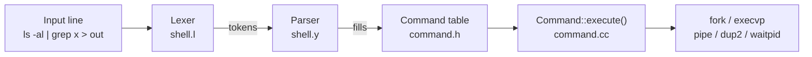

<div align="center">

# 🐚 Linux Interactive Mini Shell

**A Unix-style command-line shell in C++, using Lex and Yacc to parse commands and raw system calls to run them**

[](https://isocpp.org/)
[](https://www.kernel.org/)
[](https://www.gnu.org/software/make/)
[](https://en.wikipedia.org/wiki/Yacc)

</div>

---

## 📖 Table of Contents

- [Overview](#-overview)
- [Features](#-features)
- [Architecture](#-architecture)
- [Project Structure](#-project-structure)
- [Getting Started](#-getting-started)
- [Usage Examples](#-usage-examples)
- [Process Termination Log](#-process-termination-log)
- [Limitations](#-limitations)
- [What I Learned](#-what-i-learned)
- [Credits](#-credits)

---

## 🔍 Overview

This is an interactive shell for Linux. It shows a `myshell>` prompt, reads a command line, parses it, and runs it by working directly with processes, pipes, file descriptors, and signals, with no `system()` call and no help from another shell.

The project provides a Lex/Yacc skeleton. The work was to extend the grammar and write the execution engine, covering process creation, redirection, pipelines, background jobs, built-in commands, signal handling, and a process-termination log.

---

## ✨ Features

| Feature | Syntax | Notes |
|---|---|---|
| **Run programs** | `ls -al /etc` | `fork()` + `execvp()`, searches `PATH` |
| **Pipelines** | `cat file \| grep text \| wc -l` | Any number of commands, connected with `pipe()` + `dup2()` |
| **Output redirection** | `ls > out` | Creates or truncates the file |
| **Append redirection** | `ls >> out` | Appends to the file |
| **Input redirection** | `sort < names.txt` | Reads stdin from a file |
| **Error redirection** | `ls /missing >>& err.txt` | Sends stderr to a file |
| **Background jobs** | `sleep 30 &` | Shell returns to the prompt without waiting |
| **`cd [dir]`** | `cd /tmp`, `cd` | Built-in; with no argument goes to `$HOME` |
| **`exit`** | `exit` | Built-in; prints a goodbye message and quits |
| **Ignores Ctrl+C** | | `SIGINT` is ignored, so the shell cannot be killed by accident |
| **Termination log** | | A `SIGCHLD` handler records each child process that ends, with a timestamp |
| **Flexible spacing** | `ls\|grep a>out` | The lexer does not need spaces around `\|`, `<`, `>`, `>>`, `&` |

Redirections and the background flag can be combined with pipelines, following the grammar from the assignment:

```
cmd [arg]* [ | cmd [arg]* ]* [ > file ] [ < file ] [ >> file ] [ >>& file ] [ & ]
```

Each time a command is parsed, the shell also prints the **command table** it built (the simple commands, and the output, input, error and background settings) before running it.

---

## 🏗️ Architecture



### 1. Lexer (`shell.l`)
Splits the input into tokens: `WORD`, `PIPE` (`|`), `GREAT` (`>`), `GREAT_APPEND` (`>>`), `APPEND_AMP` (`>>&`), `LESS` (`<`), `BACKGROUND` (`&`), `EXIT`, and `NEWLINE`. Whitespace is skipped, and a word ends at any special character, which is why spaces around operators are optional.

### 2. Parser (`shell.y`)
A Yacc grammar recognizes pipelines of simple commands with optional redirections and a background flag. Its actions build the command table: they create a `SimpleCommand` for each command, add arguments to it, and record the redirection files and flags on the current `Command`. Invalid lines are skipped with Yacc's error recovery instead of crashing the shell.

### 3. Command data structures (`command.h`)
- **`SimpleCommand`**: one program and its arguments, in a dynamic array that doubles when full
- **`Command`**: the list of `SimpleCommand`s in a pipeline, plus `_inputFile`, `_outFile`, `_errFile`, `_append`, `_background`

### 4. Execution (`command.cc`)
`Command::execute()` handles built-ins first (`exit` and `cd` run inside the shell itself, without forking). Then, for external commands, it:
1. saves the shell's original stdin, stdout and stderr with `dup()`
2. creates a `pipe()` between each pair of neighbouring commands
3. opens redirection files and wires file descriptors with `dup2()`
4. runs each command in a child created with `fork()` and `execvp()`
5. waits with `waitpid()` unless the command ends with `&`
6. restores the shell's descriptors, frees the command table, and prints the prompt again

---

## 📁 Project Structure

```
Linux-interactive-Minishell/
├── shell.l       # Lex: tokenizer
├── shell.y       # Yacc: grammar and parser actions
├── command.h     # SimpleCommand and Command data structures
├── command.cc    # Execution engine, built-ins, signal handlers, main()
├── Makefile      # Build script
├── log.txt       # Example output of the termination log
```

---

## 🚀 Getting Started

### Prerequisites

- Linux (native, VM, or WSL)
- `g++`/`gcc`, `make`, `flex` (provides `lex`), and `bison` (provides `yacc`)

On Debian or Ubuntu:

```bash
sudo apt update
sudo apt install build-essential flex bison libfl-dev
```

### Build and run

```bash
git clone https://github.com/YoussefMohAttia/Linux-interactive-Minishell.git
cd Linux-interactive-Minishell
make
./shell
```

You should see the `myshell>` prompt. To remove build artifacts, run `make clean`.

> **Troubleshooting:** if the linker reports that it can't find `-ll`, install `libfl-dev` and change `-ll` to `-lfl` in the `shell:` rule of the Makefile.

---

## 💻 Usage Examples

```bash
myshell> ls -al
myshell> ls -al aaa bbb cc > outfile        # output to a file
myshell> ls -al >> outfile                  # append
myshell> cat < outfile                      # input from a file
myshell> cat < outfile > copy               # input and output redirection
myshell> ls /missing >>& errors.txt         # redirect stderr to a file
myshell> cat outfile | grep text            # pipe
myshell> ls | cat | grep c > out            # pipeline with output redirection
myshell> ls|grep command                    # spaces around | are optional
myshell> sleep 30 &                         # run in the background
myshell> cd /tmp                            # built-in: change directory
myshell> cd                                 # built-in: go to $HOME
myshell> exit
```
---

## 📝 Process Termination Log

A handler for `SIGCHLD` runs every time a child process ends and appends a line with the process ID and a timestamp to a log file. Example from `log.txt`:

```
Process 9827 terminated @ 2024-11-10 15:46:22.
Process 9828 terminated @ 2024-11-10 15:46:36.
Process 10641 terminated @ 2024-11-10 15:47:09.
```

The log location is set inside `handle_logsig()` in `command.cc`. Change that path to a location that exists on your machine.

---

## ⚠️ Limitations

This is a teaching shell, so it leaves out many features of a full shell:

- No wildcard expansion (`*`, `?`), the lab's bonus part
- No quoting, escaping, or environment-variable expansion
- No command history, line editing, or tab completion
- No job control (`jobs`, `fg`, `bg`)
- `exit` and `cd` are recognised as built-ins; other shell built-ins are not available
- Because Ctrl+C is ignored, it also won't interrupt a long-running child process

---

## 🎓 What I Learned

- Writing a **lexer with Lex** and a **grammar with Yacc**, and connecting them to C++ data structures
- The Unix process model: `fork`, `exec`, `wait`, and why some commands must be built into the shell
- Inter-process communication with `pipe()` and redirecting file descriptors with `dup2()`
- Handling asynchronous events with signals (`SIGINT`, `SIGCHLD`)
- Managing memory for dynamically growing command structures

[GitHub](https://github.com/YoussefMohAttia) · [LinkedIn](https://www.linkedin.com/in/youssefmohattia/)
